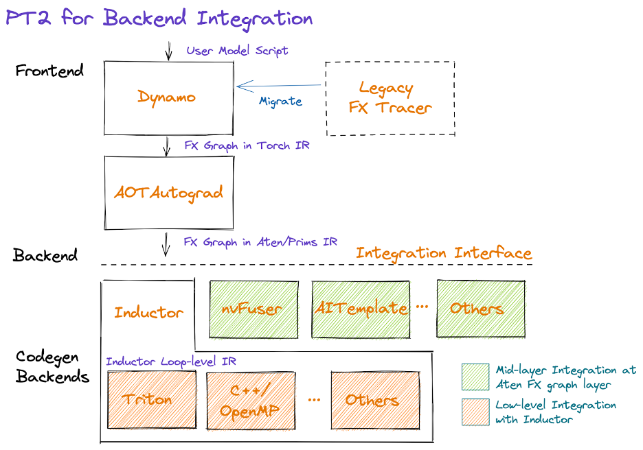

# 一、录音详情

在模型代码层面（如 forward 函数里），很难把多个 ops（比如量化层、线性层）融合成单一高效算子。除非把这些操作全部手写成一个自定义的大算子，但这样做很不灵活且不可扩展（模型有很多结构和算子组合，为每一种手写一个融合算子是不现实的）。对于很多常见但是不是特别核心的小算子，每个都自己写优化 kernel，非常耗时，并且有新硬件或者新编译器版本，又得重新优化。

所以要用到 Pytorch 的 TorchDynamo 和 Inductor 技术，在模型运行之前，将模型转换成一个计算图，然后在这个计算图上自动进行优化，这样不用修改模型代码。

但是并非所有场景都适用全自动优化。为注意力机制（Attention）这类操作进行手动融合，是因为注意力机制几乎总是使用手工高度优化的、非标准的内核。所以，任何我们想对注意力机制做的优化（比如将矩阵乘法、掩码、Softmax 等融合成一个大的 FlashAttention 内核），都需要我们手动提前做好。因此，这种为注意力机制手动编写优化内核的做法将会长期存在，不会改变。**但是我认为对于你们来说最好的方式是使用Inductor和AotAutograd.**

编译器（如 TorchInductor）虽具备自动优化能力，但其输出的全自动优化结果未必最优。理想工作流应结合“手动反函数化”：在编译器生成的函数化计算图基础上，有选择地将关键部分替换为手工优化内核。（存疑）

当前我们想进行融合优化的主要对象是 MOE 模型。但目前的 MOE 实现被封装成了一个巨大的、整体的自定义算子（具体原因没听懂）。我们希望未来能修复这些编译问题，解耦这个巨大的 MOE 算子，让它内部的细节（各个专家的计算）暴露出来。这样我们就能在计算图的层面对它进行融合优化了。

已经有人为稠密模型实现了类型的功能，他们的方法是采用了一种叫做 xxx 的技术。具体来说，就是获取模型的前向传播过程，然后通过直接转换 FX 计算图的方式，来实现计算重叠等优化。他们是在编译的早期（Dynamo捕获图的时候）做的这个优化，但我们可能希望这个优化在编译的更晚阶段进行。

vllm 目前的目标是让所有的优化 pass 都遵循一个统一的接口，我们有一个 graph pass manager，负责收集和管理所有的这些优化 pass 。**我认为对你们来说，最好的做法是：直接将这些优化 pass 导入到你们自己的 pass 管理器中，然后只挑选那些对你们有用的 pass 。**

# 二、FX Pattern Matching

```python
from torch.fx.subgraph_rewriter import replace_pattern

def register(self, patterns: List[Tuple[Callable, Callable]]):

    def pattern(rms_norm_input, residual, rms_norm_weight, scale, offset):
        output = torch.ops.npu.npu_add_rms_norm(rms_norm_input, residual,
                                                rms_norm_weight, 1e-6)
        out0 = output[0]
        out1 = output[2]
        quantized_output = torch.ops.npu.npu_quantize(
            out0, scale, offset, torch.qint8, -1, False)
        return quantized_output, out1

    def replace(rms_norm_input, residual, rms_norm_weight, scale, offset):
        output = torch.ops.npu.npu_add_rms_norm_quant(
            rms_norm_input,
            residual,
            rms_norm_weight,
            1. /
            scale,  # The inverse of scale is required by npu_add_rms_norm_quant kernel which is opposite to the npu_quantize kernel.
            offset,
            epsilon=1e-6)
        quantized_output = output[0]
        out1 = output[2]
        return quantized_output, out1

    patterns.append((pattern, replace))
    
replace_pattern(graph, pattern, replace)

```

模式匹配（Pattern Matching）：replace_pattern 是PyTorch FX的一个工具，它允许我们在图中查找特定的子图模式并用另一个子图替换它。但是，如果图中相同的功能以不同的算子序列表示，那么我们需要为每种表示编写模式。

# 三、 Aut-Autograd



AOT Autograd 会预先追踪前向和反向图（在模型实现运行前）。AOT使用__torch_dispatch__基于追踪的机制（而不是传统的fx符号跟踪）来提取正向和反向图，并将它们封装在torch.fx GraphModule容器中。Aot Autograd会将这些前向和反向图发送给用户提供的编译器。
重要特性：

1. 中间值保存：前向计算保存了反向传播所需的中间结果，避免重复计算；
2. 图表示：计算被表示为静态的计算图，便于后续优化和编译；
3. 分离关注点：前向和反向图被明确分离，可以分别进行编译优化；

```python
aot_autograd(fw_compiler=ts_compile, bw_compiler=ts_compile)(graph, example_inputs)
```

自定义后端：AOT Autograd 本身可以进行一些图级别的优化，包括操作融合。但是，AOT Autograd 的设计初衷是作为一个平台，它负责提取和准备计算图，然后将图传递给专门的后端编译器。这样设计有以下几个原因：

1. 关注点分离：AOT Autograd 的核心职责是自动微分和计算图提取，而将具体的编译和优化任务委托给后端。这样可以让不同的后端专注于它们擅长的优化，而 AOT Autograd 只需保证图的正确性。
2. 利用现有编译器的优势：不同的后端编译器（如 NNC、NVFuser、TVM、XLA 等）都有各自擅长的优化技术和目标硬件。直接使用这些后端可以充分利用它们已经实现的优化，而不需要重复造轮子。
3. 灵活性和可扩展性：通过后端接口，用户可以选择不同的编译器，甚至自定义编译器，以适应不同的硬件和性能需求。如果 AOT Autograd 自己实现所有优化，那么它的优化能力将受限于其内部实现的优化策略，而且难以扩展。

# 四、Inductor 模式匹配
Inductor 包含两部分，第一部分是对 fx 图的一些预处理标准化，第二部分是通过 codegen 结合trtion 做算子融合（第二部分昇腾不支持），因此我们可以复用 inductor 的第一部分能力。

## 1. 预处理和标准化
第一部分融合的是算子边界，将多个小算子融合成大算子，使得在下一部分的循环级别融合中，可以对大算子的内部进行更极致的优化。（多个算子被融合成一个算子，这个算子内部实现可能仍然是多个独立的循环，这些循环之间仍然存在多次读写全局内存的开销）

- 模式匹配（pattern_matcher）：torch._inductor.pattern_matcher
识别图中已知的计算模式，并将其替换为更高效的实现
例如：将量化和 rmsnorm 操作 替换为一个操作
- 分解（decomposition）：torch._inductor.decomposition
将复杂的操作分解为更简单的操作，以便后续优化和代码生成
例如：将 layernorm 分解为 mean, var, sqrt 等基础操作，使得后续优化更容易进行
- FX传递（fx_passes）：torch._inductor.fx_passes.post_grad
包括后梯度（post_grad）等传递，这些传递是在梯度计算之后进行的图优化
例如消除公共子表达式、死代码消除等

## 2. 通过 codegen 结合 triton 做算子融合

这一阶段 Inductor 会将优化后的FX图转换为中间表示（IR），然后通过代码生成（codegen）将IR转换为实际运行的代码。对于 GPU，Inductor 使用 Triton 来生成高效的 GPU 代码。算子融合是这一阶段的关键优化，它将多个操作融合为一个内核，以减少内存访问和内核启动开销。(在循环嵌套和内存访问的底层层次上进行融合，生成一个单一的内核 kernel，彻底消除中间结果的全局内存读写）

# 五、整体思路
- 通过在 CompilerConfig 中定义 oot_compiler，在进行图编译时走我们自己的后端编译器 AscendAdaptor
- 通过替换 PassManager，在模型匹配时匹配我们自定义Pass
  
```python
if compilation_config.oot_compiler:
    return resolve_obj_by_qualname(compilation_config.oot_compiler)()
```

```python
self.pass_manager = resolve_obj_by_qualname(
    current_platform.get_pass_manager_cls()
)()

```
